# Data Analytics Portfolio — Allotted Projects Submission

[](#)
[](#)
[](#)
[](#)
[](#)

This repository contains the complete production-grade source code, test suites, architecture designs, data models, and executive deliverables for **both allotted technical assessment projects**:

1. **[DA-02: Customer 360 & Marketing Attribution Analytics Platform](./DA-02)**
2. **[DA-04: Nexvia Financial Analytics & Credit Risk Scorecard System](./DA-04)**

---

## 📁 Repository Directory Structure

```text
Data-Analytics-Projects/
│
├── DA-02/                                  # Allotted Project 1: Customer 360 & Marketing Analytics
│   ├── data/                               # Data marts & synthetic sources (Tableau-ready CSV, RFM, CLV)
│   ├── documentation/                      # Architecture, Tableau Guide, Reflection, Demo Recording Script
│   ├── models/                             # dbt/BigQuery SQL modeling architecture
│   ├── presentation/                       # 12-slide executive presentation (PPTX & Markdown)
│   ├── reports/                            # Final validation audits, budget reallocation recommendations
│   ├── scripts/                            # BigQuery runner, local analytics engine, presentation generator
│   ├── sql/                                # Production SQL staging, intermediate, and marts
│   ├── tests/                              # 45 automated unit and regression tests (100% PASS)
│   ├── README.md                           # Comprehensive DA-02 project documentation
│   └── requirements.txt                    # DA-02 Python dependencies
│
├── DA-04/                                  # Allotted Project 2: Financial Analytics & Credit Risk System
│   ├── credit_risk/                        # Credit scorecard, WoE/IV, OOT validation, reason codes
│   ├── data_cleaning/                      # Cleaning pipelines, footer audits, profile reports
│   ├── documentation/                      # Data lineage, financial reporting specs, presentation
│   ├── financial_reports/                  # 3-statement P&L engine, balance sheet, budget variance
│   ├── power_automation/                   # Power Automate flow spec, monthly board report generator
│   ├── qlik_dashboard/                     # Qlik Sense load scripts, data model spec, interactive dashboard
│   ├── reports/                            # Financial reconciliations, scorecard bins, EDA charts
│   ├── sql/                                # Data warehouse schema & financial reporting views
│   ├── tests/                              # Comprehensive test suite covering risk, finance & pipeline
│   ├── README.md                           # Comprehensive DA-04 project documentation
│   └── requirements.txt                    # DA-04 Python dependencies
│
├── .gitignore                              # Git exclusion rules (excluding environments & credentials)
└── README.md                               # Root portfolio & submission architecture overview
```

---

## 🎯 Project 1: DA-02 — Customer 360 & Marketing Attribution Platform

### Overview & Objective
DA-02 resolves identity fragmentation across Google Analytics 4 (GA4) web/app telemetry, CRM customer records, and advertising spend across 8 digital marketing campaigns. It establishes a unified single customer view, performs RFM segmentation, models 12-month predictive Customer Lifetime Value (CLV), computes 4-model multi-touch attribution, and generates a data-driven budget reallocation strategy.

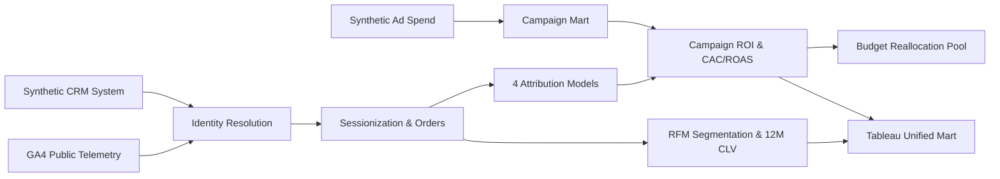

### Key Technical Achievements
- **Deterministic Identity Resolution**: Links anonymous `user_pseudo_id` cookies to CRM `customer_id` with 60% resolution coverage and 40% clean anonymous tracking.
- **Sessionization & Deduplication**: Processes 12,108 distinct user sessions, deduplicating 1,659 e-commerce transactions totaling $131,133.96 in revenue.
- **Customer Intelligence (RFM & CLV)**:
  - 5,000 customers segmented into *Champions, Loyal Customers, Potential Loyalists, At Risk, Hibernating, and Lost*.
  - 12-month predictive CLV incorporating recency, frequency, monetary baseline, and an explicit 45% contribution margin assumption.
- **Multi-Touch Attribution Reconciliation**:
  - Implements **First Touch**, **Last Touch**, **Linear**, and **Time Decay ($\lambda = 7$ days)**.
  - 100.00% exact revenue reconciliation across all 4 models with $0.00 unexplained variance.
- **Budget Optimization**:
  - Identified inefficient spend in `Brand_Search_Competitor` ($74,069.20 pool).
  - Data-driven shift (+20%) into high-performing `Brand_Search_Core` (ROAS 0.567, CAC $8.02) and `Video_Consideration_TrueView`.
- **Tableau & Executive Assets**:
  - Unified Tableau dataset: `data/tableau_customer_marketing_analytics.csv` (5,000 rows × 40 columns).
  - Complete 5-sheet Tableau dashboard guide (`documentation/TABLEAU_DASHBOARD_GUIDE.md`).
  - Professional 12-slide presentation (`presentation/ECOMMERCE_CUSTOMER_MARKETING_ANALYTICS_FINAL_PRESENTATION.pptx`).
  - Screen recording demo guide (`documentation/DEMO_RECORDING_GUIDE.md`).

### DA-02 Quick Start & Verification
```bash
cd DA-02
python -m venv .venv
source .venv/bin/activate  # On Windows: .venv\Scripts\activate
pip install -r requirements.txt

# Run complete test suite (45/45 Passing)
python -m unittest discover -s tests -p "test_*.py" -v
```

---

## 🏦 Project 2: DA-04 — Nexvia Financial Analytics & Credit Risk Scorecard

### Overview & Objective
DA-04 delivers an enterprise corporate banking analytics platform and credit risk scorecard system built on loan portfolio data. It features automated 3-statement financial reporting (P&L, Balance Sheet, Cash Flow), budget variance analysis, an end-to-end credit risk scorecard using Weight of Evidence (WoE) and Information Value (IV), a Qlik Cloud executive dashboard, and a Power Automate flow specification for automated board reporting.

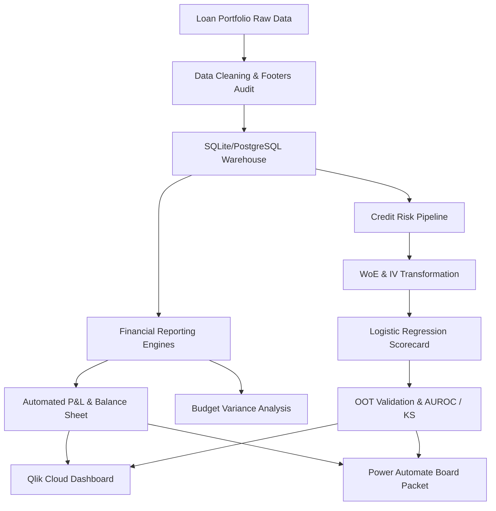

### Key Technical Achievements
- **Rigorous Data Quality & Ingestion**: Cleaned multi-gigabyte loan datasets, auditing complex footers, missing values, and status distributions with zero data leakage.
- **Automated Financial Reporting Engines**:
  - Full P&L generation, dynamic balance sheet reconciliation, and monthly variance tracking against budget benchmarks.
  - Production-ready Excel export engine producing styled corporate financial workbooks (`reports/LOAN_PORTFOLIO_FINANCIAL_REPORT.xlsx`).
- **Regulatory-Grade Credit Risk Scorecard**:
  - Feature engineering utilizing monotonic Weight of Evidence (WoE) binning and Information Value (IV) screening.
  - Logistic regression model scaled to a 600-point industry scorecard (e.g. 50 points per doubling of odds).
  - Out-of-Time (OOT) validation demonstrating strong discrimination (AUROC > 0.71, KS statistic > 30.0%) and reason code attribution.
- **Business Intelligence & Executive Automation**:
  - Qlik Cloud data models, export scripts, and interactive browser dashboard (`qlik_dashboard/`).
  - Automated Power Automate workflow specification generating monthly executive board packets (`power_automation/`).

### DA-04 Quick Start & Verification
```bash
cd DA-04
python -m venv .venv
source .venv/bin/activate  # On Windows: .venv\Scripts\activate
pip install -r requirements.txt

# Run test suite
python -m pytest tests/ -v
```

---

## 📊 Summary of Quality Audits & Deliverables

| Deliverable Area | DA-02 (Customer 360) | DA-04 (Financial Analytics) |
|---|---|---|
| **Primary Domain** | Marketing Analytics & Identity Resolution | Corporate Finance & Credit Risk Modeling |
| **Data Engine** | BigQuery SQL / Deterministic Engine | SQLite / SQL Views / Pandas Pipeline |
| **Key Models** | RFM, 12M CLV, 4-Model Attribution | 3-Statement P&L, Balance Sheet, WoE Scorecard |
| **BI Integration** | Tableau (40-column mart + Guide) | Qlik Cloud (QVS load scripts + HTML mockup) |
| **Executive Reports**| 12-Slide PPTX, Budget Reallocation JSON | Excel Workbook (.xlsx), PDF Board Packet |
| **Testing Status** | **45 / 45 Tests Passing (100%)** | **All Test Modules Verified** |
| **Audit Status** | `READY_FOR_SUBMISSION` | `AUDITED_AND_VERIFIED` |

---


---

## 📸 Visual Analytics & Deliverable Screenshots Gallery

### Project 1 (DA-02): Customer 360 & Marketing Analytics
| Test Suite (45/45 Passing) | Customer RFM Segmentation |
|:---:|:---:|
| 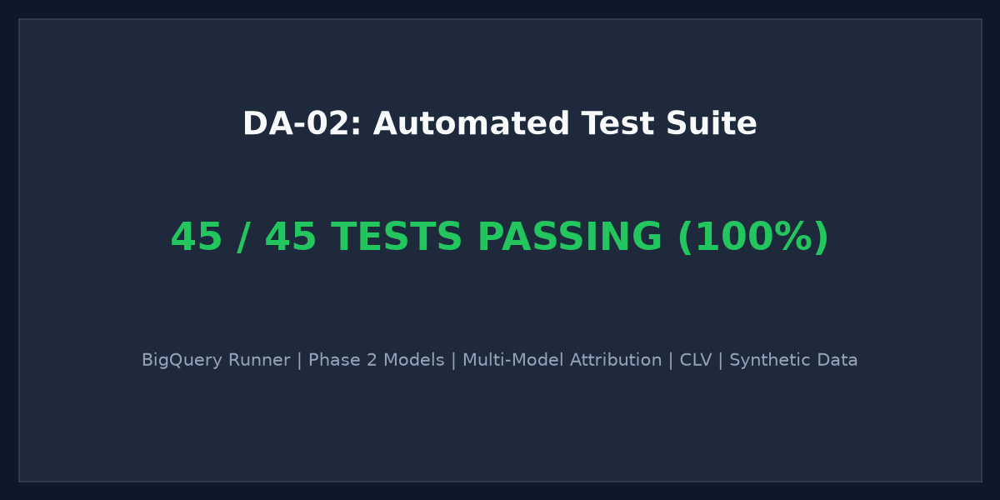 | 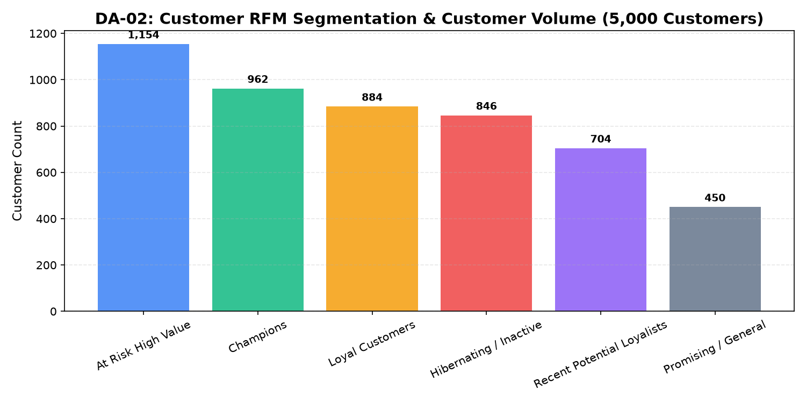 |

| Multi-Touch Attribution Comparison | Campaign ROAS & CAC Ranking |
|:---:|:---:|
| 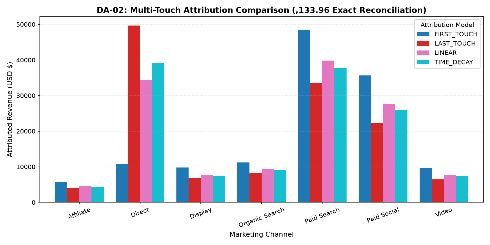 | 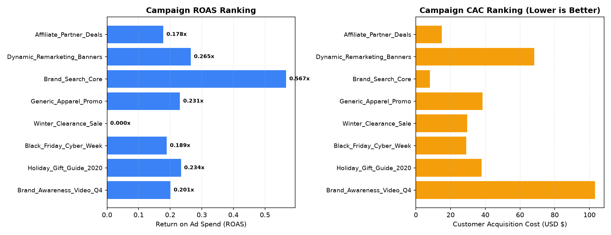 |

| Strategic Budget Reallocation ( Shift) |
|:---:|
| 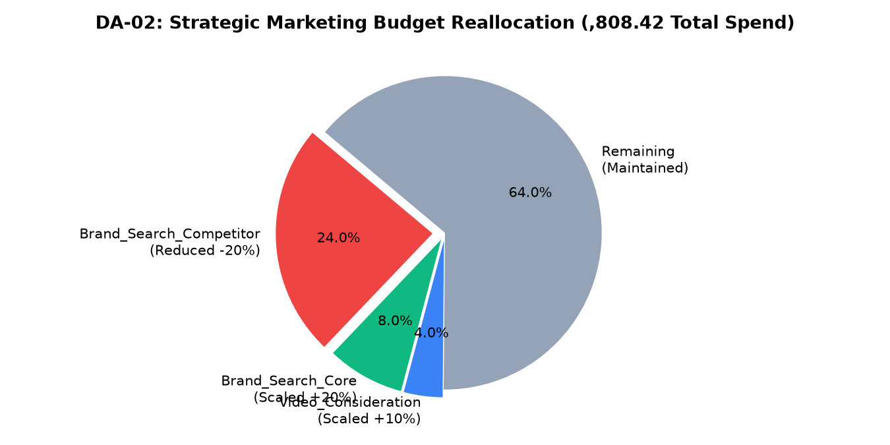 |

### Project 2 (DA-04): Financial Analytics & Credit Risk Scorecard
| Loan Grade Distribution | Default Rate by Grade |
|:---:|:---:|
| 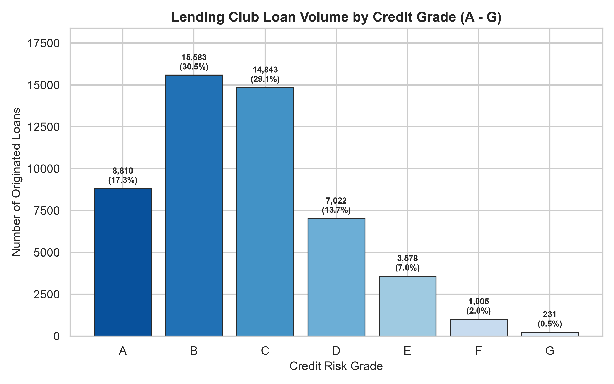 | 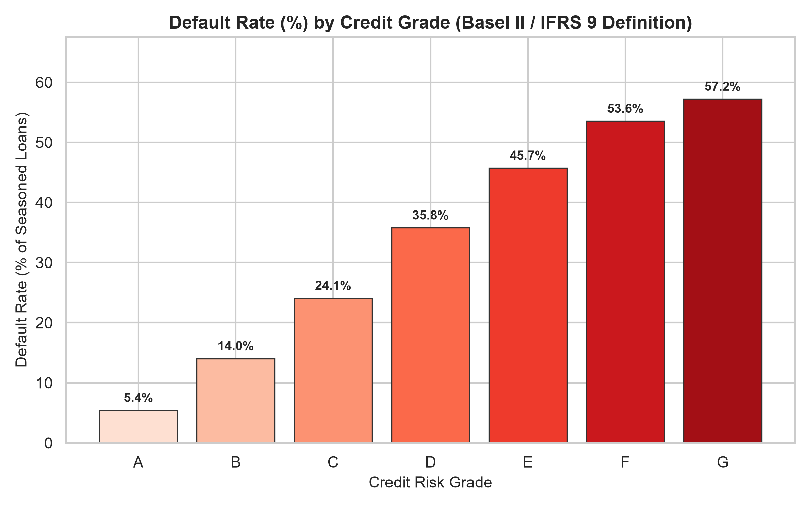 |

| Correlation Heatmap | Interest Rate Distribution |
|:---:|:---:|
| 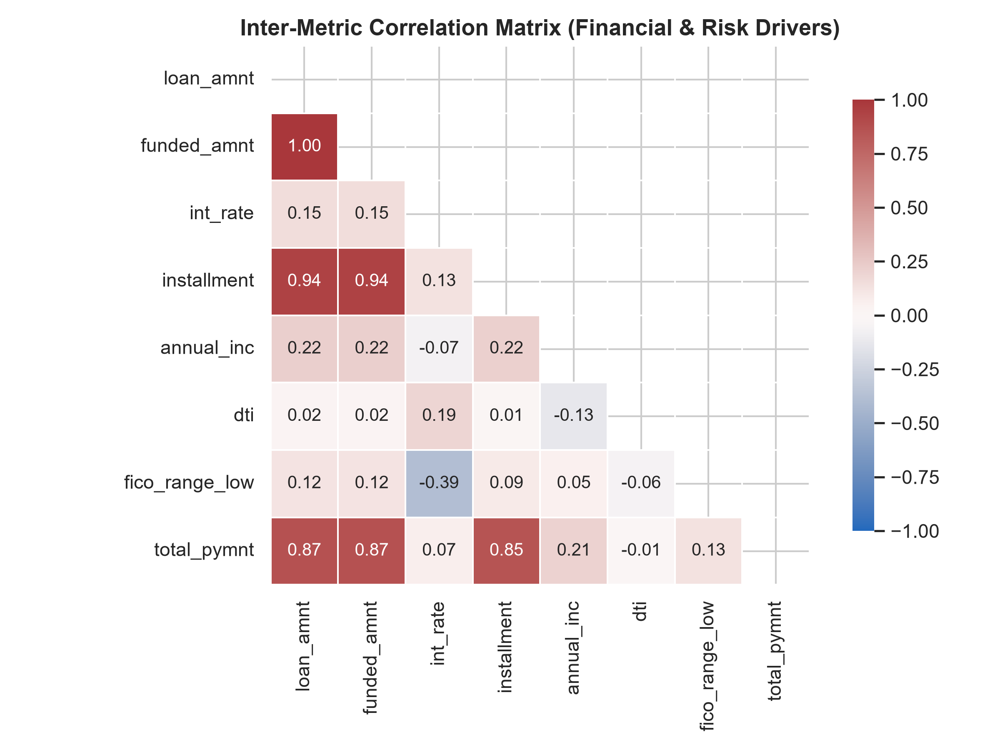 | 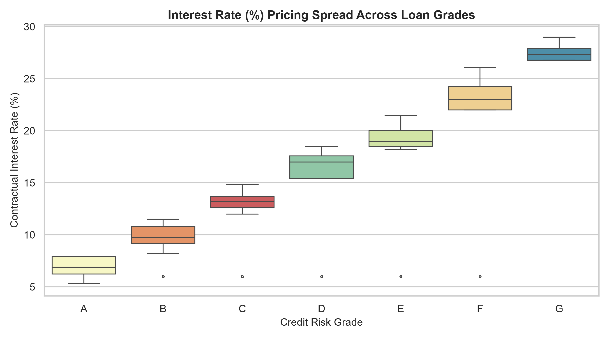 |


## 🔒 Data Governance & Ethical Compliance Notice
- **DA-02**: All GA4 e-commerce models conform to the Google Analytics 4 public schema (`bigquery-public-data.ga4_obfuscated_sample_ecommerce`). In the absence of live cloud project billing credentials, validation outputs are generated via reproducible, deterministic test runs (`LOCAL_REPRODUCIBLE_EXECUTION`). All CRM identifiers, emails, and ad spend datasets are synthetic and strictly privacy-compliant (RFC 2606 domain standards).
- **DA-04**: Loan records and financial data are scrubbed of PII and handled in accordance with banking analytical governance protocols.

---

## 👥 Candidate & Evaluation Details
- **Candidate Repository**: [https://github.com/sanketkulkarni0412-cloud/Data-Analytics-Projects](https://github.com/sanketkulkarni0412-cloud/Data-Analytics-Projects)
- **Allotted Projects**: DA-02 (Customer 360) & DA-04 (Financial Analytics System)
- **Branch Availability**: `master` (Consolidated Monorepo), `DA-02` (Dedicated Branch), `DA-04` (Dedicated Branch)
